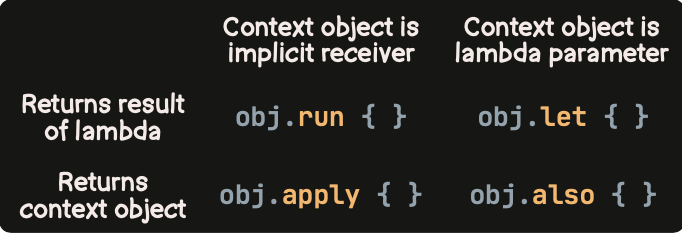
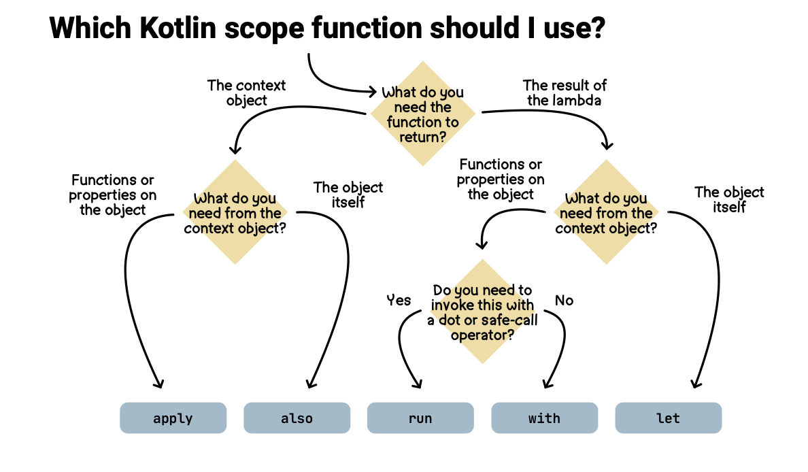

# Learning notes

These explanations were written while learning Kotlin over several years. They are collected here, alongside the runnable examples in
[`src/main/kotlin/`](../src/main/kotlin/). The basics and collections have been reviewed. Other notes still reflect what I
understood at the time and may need corrections.

- [Basics reference](basics.md)
- [Learning history](learning-history.md)

## Language and tooling

- [Why Kotlin](why-kotlin.md)
- [Gradle and build systems](gradle-and-build-systems.md)
- [Java and Kotlin interoperability](java-and-kotlin-interoperability.md)
- [Coding conventions](coding-conventions.md)
- [Idiomatic Kotlin](idiomatic-kotlin.md)
- [Kotlin 2.0 reference](kotlin-2.0.md)
- [Design patterns](design-patterns.md)

## Topics

- [Data structures](data-structures.md)
- [Classes](oop/classes.md)
- [Generics](oop/generics.md)
- [Functional programming](functional/functional-programming.md)
- [Function types](functional/function-types.md)
- [Scope functions](scope-functions.md)

## Scope function reference images

